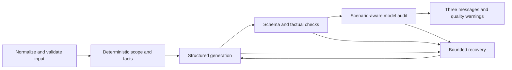

# Generation reliability iteration — 2026-11-07

The pipeline now distinguishes product scope from scenario purpose, normalizes trusted context once, and uses bounded recovery before returning a result. Hard factual failures remain blocking. Valid safe CTA variations and style differences remain warnings. The existing blue UI, catalog, customer histories and frozen evidence were preserved.

Current prompt version: **`advisor-1.4.1`**. Base commit: `ebd1ca7`. Changes are uncommitted workspace changes. The earlier live sample used `advisor-1.4.0`; its two targeted follow-ups used `advisor-1.4.1`. Their results are kept separately.

## Diagnosis and confirmed causes

The [pre-implementation diagnosis](reliability-diagnosis-2026-11-07.md) records the exact original code paths. Important findings were:

- `resolveProduct()` automatically chose a SKU for non-product reactivation and invitations. `storyFor()` could only represent a SKU story. This forced optional storytelling into product recommendations.
- Price objections without an explicitly selected SKU were rejected, even when a general response could safely acknowledge the concern.
- Global prompting demanded Motif→Line→SKU details across scenarios. This competed with greeting/invitation instructions. Full unrelated customer histories were supplied even for noncommercial greetings.
- Exact CTA enumeration and assembly checks treated harmless wording differences as malformed output. Gemstone and series matching could mistake negative statements or broad story references for product claims.
- A failed parse, schema or factual check ended generation immediately. There was no backoff, corrective repair or shared provider-call budget. Sampling was left at the provider default.
- Validation responses could be installed after their task had become obsolete. Generation already had a revision check, but synchronous duplicate submissions lacked a ref lock.
- Diagnostics hardcoded retry count zero and omitted selection depth and recovery outcome.

The first new live sample confirmed a further context/repair problem. A Christmas main copied an unrelated historical aquamarine discussion (`FACT_GEMSTONE`), and an invitation copied historical Jasmin imagery despite the selected Muguet context (`WRONG_MOTIF`). Both attempts parsed correctly; both repair calls returned the offending sentence unchanged. These were validation failures after HTTP 200, not API or JSON failures.

The subsequent fix removes irrelevant historical product conversations from greeting/event prompts, including the nested normalized-context copy, while retaining the full CRM snapshot in records. Event instructions distinguish the CA's selected motif from a verified event agenda. Repairs now include rule-specific corrective guidance and the auditor's bounded, untrusted finding data, together with canonical facts. Both targeted live retests passed.

## Architecture and behavior



Each request snapshots its normalized task, clock, assigned CA, customer context, additional notes, selected scope, canonical stories and resolved product before calling the model. Selection fields explicitly distinguish `unselected`, `unknown`, `not_applicable` and `explicit`, alongside applicability. Unknown or inconsistent selections remain invalid; an unselected optional field does not become an unknown product.

| Scenario          | Product resolution and purpose                                                                                                                                                                                                                       |
| ----------------- | ---------------------------------------------------------------------------------------------------------------------------------------------------------------------------------------------------------------------------------------------------- |
| Birthday/festival | No product required or auto-selected. Optional selected imagery can support a greeting. Existing Shanghai birthday-month rules and Christmas/Spring Festival checks remain.                                                                          |
| Recommendation    | A canonical SKU is resolved deterministically at every valid depth. Explicit SKU wins; Line and Motif restrict scope. New explicit preferences rank within that scope before historical support, then documented scores and SKU ordering break ties. |
| Care              | The selected verified purchase is the factual anchor, even if a different valid suggestion remains in selection fields. No invented purchase or after-sales policy.                                                                                  |
| Reactivation      | With no SKU, stay general or use the selected Motif/Line. No automatic product recommendation. An explicit SKU can supply restrained optional context.                                                                                               |
| Invitation        | Verified event name/time/location are primary. Motif/Line context is optional; no automatic SKU. Selected imagery does not establish an event agenda or benefit.                                                                                     |
| Price             | A selected SKU provides exact canonical facts. Without a SKU, the response acknowledges the concern generally and does not guess a price or specification. Actual concern remains essential.                                                         |

The three styles and three-paragraph contract remain. The server supplies the trusted greeting; the model supplies structured `main` and `cta`. Whitespace is normalized. Candidate style identity/count and JSON shape remain enforced. Safe CTA paraphrases can be accepted after validation/audit. Unsupported CTAs, fabricated facts, wrong material/category/SKU, unrelated product stories and internal SKU identifiers trigger blocking repair/validation.

The catalog's 15 SKUs retain their existing structure and source facts. A null gemstone is valid. A statement such as “不含钻石” is distinguished from a claim that a bracelet contains diamonds. Verified customer material preferences are distinguished from material attributed to the current product. No factual guardrail was disabled to obtain a pass.

Relevant additional context still enters every style's main paragraph. Keyword coverage is a diagnostic hint in live mode; the mandatory semantic audit checks actual use of context, including unfamiliar notes. Demo mode remains explicitly labeled and finite-vocabulary; live failures never switch silently to templates.

## Recovery and provider configuration

DeepSeek uses its documented Responses API with JSON Schema output; switching to Chat Completions was unnecessary. The parser requires the complete JSON response, not an arbitrary extracted substring. Empty, incomplete, invalid JSON and schema-invalid responses have distinct codes. Non-thinking mode remains enabled through `reasoning.effort=none`. Sampling is now explicit at temperature `0.2`; this reduces variability but does not make the model deterministic. [Official Responses reference](https://api-docs.deepseek.com/api/create-response/)

| Environment setting                | Default | Bound                                        |
| ---------------------------------- | ------- | -------------------------------------------- |
| `GENERATION_MAX_PROVIDER_CALLS`    | 4       | 2–8, counting generation, audit and recovery |
| `GENERATION_MAX_TRANSIENT_RETRIES` | 1       | 0–3 per request                              |
| `GENERATION_MAX_OUTPUT_REPAIRS`    | 1       | 0–2 per request                              |
| `GENERATION_TIMEOUT_MS`            | 45000   | 1000–90000 per provider call                 |
| `GENERATION_OUTPUT_TOKENS`         | 2400    | 1200–6000                                    |
| `GENERATION_BACKOFF_MS`            | 1000    | 0–10000; exponential backoff, bounded wait   |

Timeout/network/rate-limit/5xx failures can receive a limited retry. `Retry-After` is respected; if it exceeds the bounded waiting window, the request fails rather than retrying earlier. Authentication, billing and invalid configuration are not repeatedly retried.

Malformed output receives a constrained retry carrying the original error. A factual failure repairs only identified candidates where possible, preserving the others. A malformed audit rechecks the existing candidates. Every repaired result must pass deterministic validation and a fresh audit. Exhausting the shared budget cannot return an unaudited repair.

Safe diagnostics record request ID, source, scenario, selection depth, resolved SKU, model, API status, Responses completion status, parse/schema outcomes, failed rule IDs, affected candidate indices, warnings, retry counts and outcome. Model-provided audit text is not printed as a diagnostic log. Development console logging is optional; safe stage metadata is retained with records. Keys and raw headers are not logged, and persisted records defensively redact the configured key. `.env` was not modified or exposed.

The frontend keeps loading active through bounded recovery and explains that temporary problems may be retried. It rejects obsolete validation responses, protects generation with a synchronous lock and retains the existing revision guard. Selection, editing, copy and history remain intact.

## Actual test results

| Check                                         | Result                                                                       |
| --------------------------------------------- | ---------------------------------------------------------------------------- |
| Complete automated suite                      | **600 passed, 0 failed, 0 skipped**                                          |
| Broad mocked pipeline matrix                  | **453/453 passed**, 906 mocked provider responses, **0 real provider calls** |
| Production build                              | Passed                                                                       |
| Existing production smoke                     | Passed with isolated demo records; no paid API calls                         |
| React replay of captured real bracelet result | Passed: three displayed messages, live model label; **0 new provider calls** |
| Diff whitespace check                         | Passed                                                                       |
| Protected-file hashes                         | **101/101 unchanged**, including **79/79 frozen evaluation files**           |

The matrix covers six scenarios, all five supported selection depths where applicable, all 15 SKUs and all three product categories. It includes empty/relevant context, sparse profiles, conflicting history, all stored purchases, festival greetings and difficult/general price concerns. Mock provider replies are deterministic fixtures and do not constitute LLM quality scores.

Recovery tests exercise fenced/malformed JSON, empty/truncated/schema-invalid responses, candidate-specific material/category/internal-ID repairs, fresh audits, persistent factual rejection, malformed audits, safe alternative CTAs, Retry-After, exhausted budgets and invalid configuration. Thirty repeated resolver trials verify deterministic selection, not model repeatability. DOM tests cover synchronous duplicate clicks, late validation, obsolete generation results, loading, selection, copy, editing and history.

## Actual limited live results

All real calls used `deepseek-flash`. The original plan was eight application requests with a shared cap of 24 provider calls. The first sample used 16 calls. After its two failures exposed the history-contamination issue, only those two cases were retested; they used another four calls. **Total: 10 application attempts, 20 provider calls.** No further live calls were made.

| Stage/version                       | Application attempts | Successful | Provider calls | Parse/schema failures |
| ----------------------------------- | -------------------- | ---------- | -------------- | --------------------- |
| Initial sample, `advisor-1.4.0`     | 8                    | 6          | 16             | 0 / 0                 |
| Targeted follow-up, `advisor-1.4.1` | 2                    | 2          | 4              | 0 / 0                 |
| Combined, mixed versions            | 10                   | 8          | 20             | 0 / 0                 |

The initial failures remain failures in their original files. The combined measured success rate is **8/10**, not a claim that the final version has an 80% population success rate. The corrected version was live-tested only on its two affected scenarios; the six previously successful cases were not rerun. Do not interpret the targeted 2/2 result as 100% system reliability.

| Scenario/product                                   | Initial outcome                                | Targeted follow-up                     |
| -------------------------------------------------- | ---------------------------------------------- | -------------------------------------- |
| Christmas greeting, no product                     | Blocked unrelated aquamarine product topic     | Passed without product/history leakage |
| Recommendation, `JAS-B01`, personal, context       | Passed                                         | Not rerun                              |
| Care, verified `JAS-N01` purchase, styling context | Passed                                         | Not rerun                              |
| Reactivation, sparse client, no product            | Passed                                         | Not rerun                              |
| Invitation, Muguet Motif only                      | Blocked unrelated Jasmin history               | Passed with optional motif context     |
| Price objection, no SKU, competitor comparison     | Passed generally without guessed product facts | Not rerun                              |
| Recommendation, `FEU-V-R01`, gift                  | Passed                                         | Not rerun                              |
| Identical second `JAS-B01` request                 | Passed                                         | Not rerun                              |

The two bracelet inputs were byte-for-byte equal and both succeeded without recovery. That is two trials, not a reliable estimate of stochastic failure probability. The eight released results contain 24 Chinese messages. Soft CTA/style/story-depth warnings were retained; genuine failed outputs were withheld.

Across the ten live attempts, parse and schema failure rates were 0/10. Two attempts had deterministic factual/scope failures before a model audit; their automatic repair recovery was **0/2** in the initial version. There were no model-audit factual rejections among the successful audited cases. These are different measurements: zero audit rejections does not erase the two earlier blocking validations. The final guided repair behavior is covered by mocks but did not need to run in the two successful follow-ups.

Reported token usage across the 20 provider calls: 115,709 input tokens, including 32,128 cached; 3,725 output tokens. Applying the published Flash off-peak/peak token rates gives approximately **$0.015–$0.030**, before account-specific billing effects. This is a pricing-derived estimate, not a provider invoice. [Official pricing](https://api-docs.deepseek.com/quick_start/pricing/?model_version=DeepSeek-V4-Pro-0813)

## Evidence locations

- Final combined metrics, source fingerprints and complete test log: [verification summary](../runtime/reliability/advisor-1.4.1/verification-2026-11-07T17-47-18-418Z/summary.json).
- Final mock matrix: [summary](../runtime/reliability/advisor-1.4.1/mock-matrix-2026-11-07T17-45-45-747Z-1eabc757/summary.json), with per-case inputs, messages, validation and execution source in the same directory.
- Initial live sample: [summary](../runtime/reliability/advisor-1.4.0/live-sample-2026-11-07T17-23-31-720Z-91050159/summary.json), with original failures and provider traces.
- Corrected targeted live follow-up: [summary](../runtime/reliability/advisor-1.4.1/live-sample-2026-11-07T17-28-26-605Z-a746e8e5/summary.json).
- React replay: [verification](../runtime/reliability/advisor-1.4.0/live-sample-2026-11-07T17-23-31-720Z-91050159/ui-replay-verification.json).
- Final 50-case input plan, **not executed**: [plan](../runtime/reliability/advisor-1.4.1/plan-50-2026-11-07T17-39-52-468Z-f97cde22/plan.json).

Every new run uses an exclusive versioned directory. No baseline, previous live output, prior report, Brand Bible or fixture data was overwritten. The initial diagnosis retains the original eight-request plan; this report explains the two necessary follow-ups within the unchanged 24-call cap.

## Files changed

| Files                                                                                               | Purpose                                                                                          |
| --------------------------------------------------------------------------------------------------- | ------------------------------------------------------------------------------------------------ |
| `server/generation-context.mjs` (new)                                                               | Normalized task, selection states and canonical grounding                                        |
| `server/prompt-context.mjs` (new)                                                                   | Scenario-relevant history and specific repair guidance                                           |
| `server/recovery-policy.mjs` (new)                                                                  | Configurable shared call budget, transient backoff and repair limits                             |
| `server/reliability-metrics.mjs` (new)                                                              | Explicit rate numerators/denominators and scenario/SKU/depth breakdowns                          |
| `server/rules.mjs`                                                                                  | Scope-aware resolution, general price requests, fact/identifier validation                       |
| `server/message-contract.mjs`                                                                       | Broader story levels and safe CTA assembly                                                       |
| `server/generation.mjs`                                                                             | Scenario-aware JSON prompts, explicit sampling, targeted repair and repeated audit orchestration |
| `server/audit-policy.mjs`                                                                           | Scope-aware semantic rules and preserved finding data for repair                                 |
| `server/output-assessment.mjs`                                                                      | Indexed hard findings and soft CTA/style warnings                                                |
| `server/generation-errors.mjs`                                                                      | Configuration/budget errors and recovery metadata                                                |
| `server/communication-context.mjs`                                                                  | Avoid inventing commuting when notes only say everyday wear                                      |
| `server/index.mjs`                                                                                  | Recovery settings, always-retained safe diagnostics, typed failure records and key redaction     |
| `src/main.jsx`                                                                                      | Freshness checks, duplicate-submission lock and restrained retry/loading copy; no layout changes |
| `scripts/reliability.mjs` (new)                                                                     | Provider-aware immutable mock/sample/50-case runner with paid-batch guard                        |
| `tests/reliability-cases.mjs`, `tests/reliability-matrix.test.mjs`, `tests/recovery.test.mjs` (new) | Broad matrix and bounded fault/recovery tests                                                    |
| Existing API/rules/context/diagnostics/UI tests and `tests/cases.mjs`                               | Updated active expectations plus stale-response regression checks                                |
| New diagnosis and this report                                                                       | Reviewable findings, method, results and limitations                                             |

## Running and evaluation readiness

The system is ready for a **controlled, budget-approved final evaluation**, not a claim of production-wide reliability. The new runner supports DeepSeek and preserves outputs. Do not use the historical `npm run evaluate` / `evaluate:live` path: it remains OpenAI-key-gated and writes fixed historical paths. Frozen baseline tools/snapshots remain unchanged.

```sh
# Local regression and free deterministic matrix
npm test
node scripts/reliability.mjs --suite matrix

# Prepare/review all 50 inputs with zero provider calls
node --env-file-if-exists=.env scripts/reliability.mjs --live --suite 50 --plan --max-api-calls 200

# Start the existing application
npm run dev
```

Open `http://127.0.0.1:5173`. The existing `.env` is loaded by the backend; keys stay server-side. `npm run build` plus `npm start` serves the production build on `http://127.0.0.1:3001`.

Large live suites are blocked unless the operator supplies `--confirm-large-live` and an explicit `--max-api-calls` after reviewing cost and obtaining the user's approval. No such run was authorized or executed here. The saved 200-call plan is a budget ceiling, not 200 calls already performed. A future cost estimate should use the current input plan, token caps and then-current provider pricing before approval.

Remaining limitations: only three distinct SKUs, not all 15, were exercised live in this sample; selection depths 2/3 were tested broadly with mocks rather than a separate live sweep; the same configured model generates and audits, so correlated mistakes remain possible; unfamiliar context still relies on model semantics; bounded recovery can legitimately exhaust its budget; human review of factual nuance, Chinese naturalness, CTA quality and style remains necessary. UI verification was DOM-based, including a replay of captured live output; this phase did not add a new visual-browser or OS clipboard assessment.
